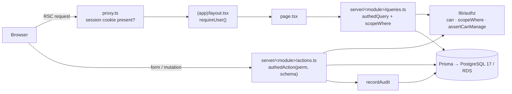

# 01 · Architecture

## Shape
Hosting and infrastructure are covered in [11-aws-deployment.md](11-aws-deployment.md).

A **modular monolith** on Next.js 16 App Router. React Server Components render pages. Server Actions handle writes. One PostgreSQL 17 database (AWS RDS in production, a Docker container locally) is accessed through Prisma. No separate API service. Route handlers exist only for file downloads, webhooks and Better Auth.



## Layers and responsibilities

| Layer | Location | Does | Never does |
|---|---|---|---|
| Edge gate | `src/proxy.ts` | Redirects to `/login` when there's no session cookie | Authorization decisions |
| Route | `src/app/(app)/**/page.tsx` | Parse params, call queries, compose components, `requirePermission()` for page access | Prisma calls, business rules |
| Query | `src/server/<module>/queries.ts` (`server-only`) | Read via Prisma with `scopeWhere`, map to DTOs | Writes |
| Action | `src/server/<module>/actions.ts` (`"use server"`) | Validate (Zod), authorize, write in a transaction, audit, revalidate | Redirects, throwing for expected errors |
| Authz | `src/lib/authz/*` | Catalog, `can`, `scopeWhere`, `assertCanManage`, `getCurrentUser` | DB writes |
| Validation | `src/lib/validation/*` | Zod schemas shared client/server | Side effects |
| UI | `src/components/**` | Presentation, client interactivity, forms | Direct data access |

## Folder layout
```
mcsu-console/
├─ prisma/
│  ├─ schema.prisma            # see docs/reference/schema.draft.prisma
│  ├─ migrations/
│  └─ seed.ts                  # catalog sync → groups → lookups → super admin
├─ public/brand/               # logo.png, logo-white.png, mark.png, mark-white.png
├─ src/
│  ├─ app/
│  │  ├─ (auth)/login | register | forgot-password | pending
│  │  ├─ (app)/
│  │  │  ├─ dashboard/
│  │  │  ├─ employees/ [id]/ new/
│  │  │  ├─ projects/  [id]/ new/
│  │  │  ├─ one-lot/   [id]/(summary|backlog|board|calendar|documents)
│  │  │  ├─ activity-reports/ monitoring/
│  │  │  ├─ staff-augmentation/
│  │  │  └─ admin/ users | groups | groups/[id] | audit | maintenance | settings
│  │  ├─ api/auth/[...all]/route.ts
│  │  ├─ layout.tsx  globals.css  error.tsx  not-found.tsx  forbidden.tsx
│  ├─ components/ ui/ layout/ brand/ <module>/
│  ├─ server/<module>/{queries,actions,types}.ts
│  ├─ lib/
│  │  ├─ authz/ catalog.ts policy.ts scope.ts session.ts action.ts
│  │  ├─ audit.ts  db.ts  auth.ts  auth-client.ts  env.ts  navigation.ts
│  │  └─ validation/
│  ├─ hooks/
│  └─ proxy.ts
├─ tests/ unit/ e2e/
└─ docs/
```

## Request lifecycle (read)
1. `proxy.ts` checks that the session cookie exists. If it doesn't, it redirects to `/login?next=…`.
2. `(app)/layout.tsx` calls `requireUser()`. That loads the session, user, group, grants and led-team ids **from the database on every request**, memoized with React `cache()`. Pending or suspended users are redirected to `/pending`.
3. The sidebar is built from `navigation.ts`, filtered by `can()`.
4. The page calls `requirePermission("employee.view")`, which renders the `forbidden()` page if it fails.
5. The query runs `authedQuery("employee.view", …)`, which applies `scopeWhere(user, "employee.view")` to the Prisma `where`.

## Request lifecycle (write)
`authedAction({ permission, schema, audit }, handler)`:
1. Resolve the current user (active only).
2. `can(user, permission)`. If it fails, return `{ ok:false, error:"FORBIDDEN" }`.
3. `schema.safeParse(input)`. If it fails, return `{ ok:false, error:"VALIDATION", fieldErrors }`.
4. Run the handler inside `prisma.$transaction`. The handler **re-checks scope** on the target row (e.g. `findFirst({ where: { id, ...scopeWhere(...) } })`).
5. Write the audit entry in the same transaction.
6. `revalidatePath`/`updateTag`, then return `{ ok:true, data }`.

## Caching
- Authz data is **never cached across requests** (fixes the mcsu-app 5-minute cookie-cache bug). Better Auth `session.cookieCache` stays **disabled** for user/group data.
- Lookups (maintenance tables) may use `"use cache"` with a tag such as `lookup:client`, and get `updateTag` on mutation.
- Dashboards may cache for 60s with tags. Scoped dashboards must include the user's scope key in the cache key.

## Files and documents
Phase 2 adds documents (One-Lot, certifications, MAR attachments) behind a `DocumentStorage` interface. There are two implementations: `local` (dev) and `sharepoint` (preview/prod, via Microsoft Graph). See [ADR 0007](adr/0007-sharepoint-document-storage.md).

## Background jobs
Phase 2+ needs jobs such as contract renewal reminders and MAR reminders. Use **EventBridge scheduled API destinations** calling signed `/api/cron/*` route handlers ([11-aws-deployment.md §5](11-aws-deployment.md#7-scheduled-jobs)). No separate worker for now.
