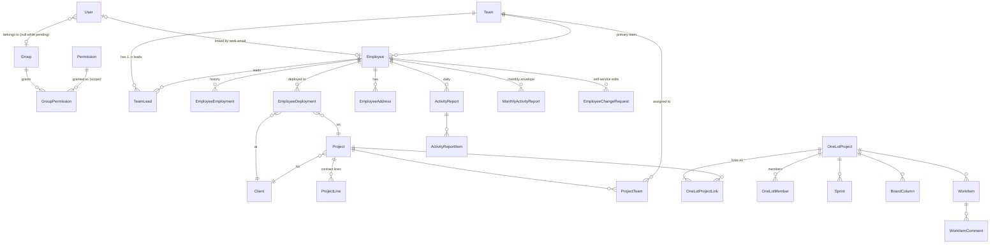

# 04 · Data model

The full draft schema is [reference/schema.draft.prisma](reference/schema.draft.prisma). In Phase 1 it gets copied to `prisma/schema.prisma`. This page explains the shape and the rules behind it.

## Entity map

Staff Augmentation has no tables of its own. It's a view over `EmployeeDeployment` on Staff-Aug S3Ps ([staff-augmentation](modules/staff-augmentation.md)).

## Key relationships

| Relationship | Cardinality | Why |
|---|---|---|
| User → Group | many-to-one, nullable | One group per user keeps rank unambiguous. `null` = pending (no grants) |
| User ↔ Employee | one-to-one, optional | Auto-linked on approval when `user.email == employee.workEmail` (case-insensitive). Can also be linked manually in User Management |
| Employee → Team | many-to-one (primary team) | Drives TEAM scope. See [Q1](08-open-questions.md) for multi-team membership |
| Team ↔ Employee (leads) | many-to-many via `TeamLead` | A team can have several leads, and one person can lead several teams |
| Project (S3P) ↔ Team | many-to-many via `ProjectTeam` | A project can be delivered by several teams |
| One-Lot ↔ Project (S3P) | many-to-many via `OneLotProjectLink`, **≥1** | e.g. one Implementation S3P + one Maintenance S3P run by the same team in one workspace |
| Employee → Deployment → Project/Client | history | Staff Aug renewal status is derived from the latest deployment's `endDate` |

## Derived values (never stored)

| Value | Derivation |
|---|---|
| Employee "resigned" | `resignationDate != null && resignationDate <= today` |
| Current position/level/type | latest `EmployeeEmployment` where `endDate is null` (or max `startDate`) |
| Current client/project | latest `EmployeeDeployment` |
| Renewal status | from latest deployment `endDate`: `NO_PROJECT`, `ONGOING`, `RENEWAL_SOON` (≤ `staffAug.renewalThresholds.soon`, default 45 days), `RENEWAL_URGENT` (≤ `.urgent`, default 30), `ENDED` (ported from `mcsu-app/src/lib/staff-augmentation-status.ts`) |
| Working day | weekday not in the `Holiday` lookup |
| Project gross profit / margin | `Σ contractPrice − Σ estimatedCost` |
| Sprint velocity, burndown | from `WorkItem.doneAt`, `storyPoints`, sprint dates |
| User display (User Management) | if `employee` is linked: full name, position, team, photo; else `user.name` + `user.email` |

## Data rules
- **Soft delete:** `Employee.deletedAt`, `Project.deletedAt`, `OneLotProject.archivedAt`. Default queries exclude them. `employee.restore` brings them back.
- **Lookups** are deactivated (`isActive=false`), not deleted, once they're referenced (`onDelete: Restrict`).
- **Ordering:** backlog and board use **fractional indexing** (`rank`/`boardRank` strings, e.g. the `fractional-indexing` package). Moving one card updates one row, instead of renumbering everything as mcsu-app did.
- **Partial unique indexes** (Prisma can't express them), added in a raw SQL migration:
  - One active sprint per One-Lot: `CREATE UNIQUE INDEX sprint_one_active ON sprint("oneLotProjectId") WHERE status = 'ACTIVE';`
  - Exactly one default group: `CREATE UNIQUE INDEX group_one_default ON "group"("isDefault") WHERE "isDefault";`
  - One pending change request per employee: `CREATE UNIQUE INDEX change_request_one_pending ON employee_change_request("employeeId") WHERE status = 'PENDING';`
- **Work item code:** `<OneLot.key>-<n>`. `n` comes from `nextItemNumber`, incremented in the same transaction with `UPDATE … RETURNING`.
- **Case-insensitive email:** store lowercased; add a `citext` or `lower()` unique index in a migration.
- **Timezone:** app timezone `Asia/Manila`. Date-only fields are `@db.Date`; instants are `timestamptz`.
- **Money visibility:** salary and allowances are only returned by queries when the caller has `employee.view_compensation` in scope. Contract price, cost and profit need `project.view_financials`. These are **field-level** guards inside the query mappers.

## Seed data (fresh start)
There is **one seed script**, `prisma/seed.ts`, for every environment. It runs on every deploy (`migrate` job) and follows one rule: **check whether each record exists, and skip it if it does.** It never updates or deletes data that's already there, so admins' later edits (group grants, renamed lookups, deactivated rows) are never overwritten. Each record is matched on its natural unique key (group `name`, lookup `name`, holiday `date`, user `email`, employee `workEmail`, project `s3pNumber`).

It runs in this order:
1. **Permission catalog sync** (`syncCatalog()`). This is the **one exception** to "skip if exists": `Permission` rows mirror `catalog.ts` in code, so new keys are inserted, labels are refreshed, and keys removed from the catalog are deleted (their grants cascade). Without this, a removed permission would linger in groups ([03 §3](03-rbac.md#catalog-sync)).
2. **Groups:** Super Admin (0, system), Administrator (10), Manager (20), Team Lead (30), Employee (40, `isDefault`), Viewer (50), all with `audience = STAFF`. A missing group is created with the grants from [03-rbac.md §2a](03-rbac.md#2a-seed-grant-matrix). An existing group is skipped, grants included.
3. **Lookups:** Gender, Employment Type (Regular, Probationary, Project-Hired, Consultant), Engagement Type (Staff Augmentation, One-Lot, Managed Services, Implementation, Maintenance), Levels, a starter list of Positions, and the current year's Philippine Holidays. Each value is skipped if it exists.
4. **Super Admin user** from `SEED_SUPERADMIN_*`. Skipped if any user with that email exists.
5. **Demo data** (`SEED_DEMO=1`, local and staging only): demo teams, employees, projects, a One-Lot with a sprint, and activity reports. Each record is skipped if it exists. The seed **refuses** to load demo data when `APP_ENV=prod`.

The seed logs a summary per step (`created 3, skipped 12`).
