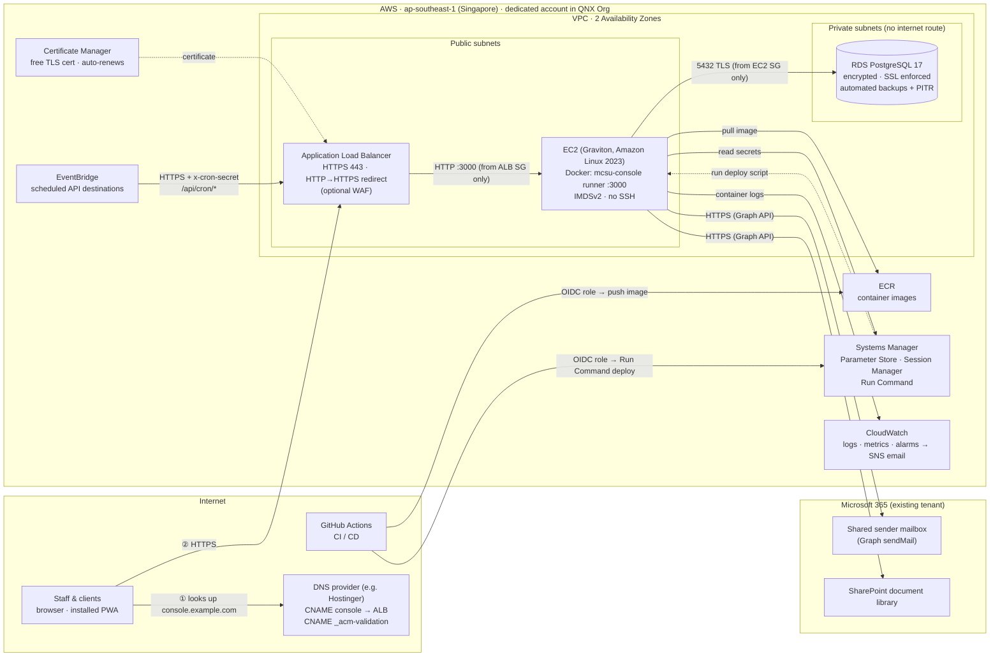
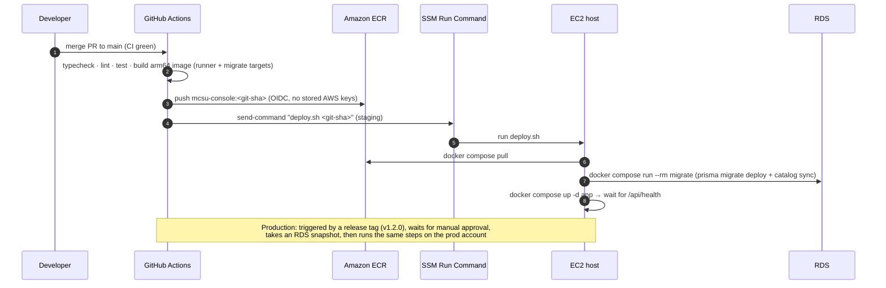

# 11 · AWS deployment

Production and staging run on **AWS in Singapore (`ap-southeast-1`)**: the Docker `runner` image on **EC2** behind an **Application Load Balancer (ALB)** with a free **ACM** certificate, plus **RDS for PostgreSQL 17**. DNS stays with the domain's current provider (e.g. Hostinger), which just points a subdomain at the ALB. Decision: [ADR 0011](adr/0011-aws-ec2-rds.md) and [ADR 0012](adr/0012-dns-at-registrar-alb-https.md). The image itself is described in [10-docker.md](10-docker.md). A visual version of this page is in [architecture/mcsu-console-aws.html](architecture/mcsu-console-aws.html).

## 1. Architecture



## 2. Domain, DNS & HTTPS
There's no CloudFront and no Route 53. The browser asks the DNS provider where `console.example.com` is, then connects **directly to the ALB**, which holds a free ACM certificate.

| Record (at the DNS provider, e.g. Hostinger hPanel → DNS) | Type | Value | Purpose |
|---|---|---|---|
| `_<token>.staging-console` | CNAME | `_<token>.acm-validations.aws` | Proves we own the name. **Keep it forever**, because ACM uses it for automatic renewal |
| `staging-console` | CNAME | `<staging-alb>.ap-southeast-1.elb.amazonaws.com` | Sends users to the staging ALB |
| `_<token>.console` | CNAME | `_<token>.acm-validations.aws` | Production certificate validation (at go-live) |
| `console` | CNAME | `<prod-alb>.ap-southeast-1.elb.amazonaws.com` | Production (at go-live) |

- **Subdomains only.** The ALB's IP addresses change, so it must be referenced by name (CNAME), and most providers (including Hostinger) don't allow a CNAME on the bare domain. Using the bare domain would need Route 53 (alias record). That's not planned.
- **Staging** uses a subdomain on a domain we control now (e.g. a Hostinger-managed domain). **The production domain is decided at go-live** ([Q18](08-open-questions.md)). It uses the same two records on whichever provider runs that domain's DNS.
- Changing a live address later means users sign in again and reinstall the PWA once (a new origin). Pick the production address as the one to keep.
- Use a low TTL (300s) on the `console` CNAME during the first weeks so changes take effect quickly.

## 3. Network security groups (chained, least privilege)
| Security group | Inbound | From |
|---|---|---|
| `sg-alb` | 443, 80 (redirects to 443) | `0.0.0.0/0` |
| `sg-app` (EC2) | 3000 | `sg-alb` only |
| `sg-db` (RDS) | 5432 | `sg-app` only |

The EC2 instance sits in a public subnet so it can reach ECR, SSM and Microsoft Graph without a NAT gateway, but **nothing can reach it except the ALB**. Admin access goes through **Session Manager** (port 22 is closed, no key pairs). For a stricter posture later, move EC2 to private subnets with a NAT gateway (this adds a fixed monthly cost).

## 4. Environments

| | Staging | Production |
|---|---|---|
| AWS account | `qnx-mcsu-console-staging` | `qnx-mcsu-console-prod` |
| URL | `https://staging-console.<current domain>` | `https://console.<domain decided at go-live>` |
| EC2 | 1 × `t4g.small` | 1 × `t4g.medium` (start), resize as needed |
| RDS | `db.t4g.micro` | `db.t4g.small`, gp3 storage with autoscaling, **Multi-AZ off at launch** (turn on if downtime tolerance requires it) |
| Backups | 7 days | 14–35 days + manual snapshot before each release |
| Deploys | Automatically on merge to `main` | On a release tag, with **manual approval** (GitHub Environment protection) |
| Data | Seed + demo data | Real data |

Sizes are starting points for a department-scale app (< 500 users). Watch CloudWatch for two weeks after go-live and resize then.

## 5. Deployment method

### 5.1 One-time setup (per environment)
Do it for **staging** first (milestone 1.1b), and repeat for **production** at go-live.

| # | Step | Who | How |
|---|---|---|---|
| 1 | Create the member account and team access | QNX AWS Org admin | Org → new account in the right OU; IAM Identity Center permission sets |
| 2 | Bootstrap Terraform state | Dev lead | S3 bucket (versioned, encrypted) + DynamoDB/S3 lock in the account |
| 3 | Provision infrastructure | Dev lead | `cd infra && terraform workspace select staging && terraform apply`. Creates the VPC, security groups, ALB (HTTP listener + redirect), EC2 from the launch template, RDS, ECR, SSM parameter **names**, CloudWatch alarms, EventBridge rules, GitHub OIDC role |
| 4 | Request the certificate | Terraform (step 3) | ACM certificate for `staging-console.<domain>`, DNS validation. Terraform outputs the validation CNAME |
| 5 | Add the validation record | Whoever manages DNS | Add the CNAME from step 4 at Hostinger. Wait for ACM status **Issued** (minutes to 1 hour) |
| 6 | Enable HTTPS | Dev lead | `terraform apply` again: the HTTPS 443 listener uses the issued certificate |
| 7 | Point the name at the ALB | Whoever manages DNS | CNAME `staging-console` → the ALB DNS name (Terraform output) |
| 8 | Fill in secrets | Dev lead | Set values in Parameter Store `/mcsu-console/staging/*` (DB URLs, `BETTER_AUTH_SECRET`, Azure/Graph values, `CRON_SECRET`, `SEED_SUPERADMIN_*`) |
| 9 | Create database users | Dev lead | One-off SQL through Session Manager port forwarding: `migrator` (owns the schema) and `app_user` (read/write only) |
| 10 | First deploy | Dev lead | GitHub → Actions → **Deploy** → *Run workflow* (environment: staging). The `migrate` job creates the tables and seeds the Super Admin |
| 11 | Smoke test | Team | Sign in as Super Admin, check `/api/health`, install the PWA on a phone, send a test email |

The EC2 **launch template user-data** installs Docker + the Compose plugin, the CloudWatch agent, the SSM agent (preinstalled on Amazon Linux 2023), `/opt/mcsu/deploy.sh` and `/opt/mcsu/compose.aws.yaml`. A replaced instance comes back ready, and the next deploy starts the app.

### 5.2 Every release



**Workflows** (`.github/workflows/`):
| File | Trigger | Does |
|---|---|---|
| `ci.yml` | every PR | typecheck, lint, unit + integration tests (Postgres service), Docker build (no push) |
| `deploy.yml` | push to `main` → staging; tag `v*` → production (approval required); manual *Run workflow* with any tag | build + push image to the environment's ECR, (prod) RDS snapshot, SSM `send-command` → `deploy.sh <tag>`, wait for the result, post a summary |

**`deploy/deploy.sh <tag>`** (runs on the EC2 host as root, via SSM):
```bash
#!/usr/bin/env bash
set -euo pipefail
TAG="$1"; ENV_NAME="$(cat /opt/mcsu/env-name)"; cd /opt/mcsu
# 1. secrets → root-only env file
aws ssm get-parameters-by-path --path "/mcsu-console/$ENV_NAME/" --with-decryption --recursive \
  --query 'Parameters[].[Name,Value]' --output text \
  | awk -F'\t' '{n=$1; sub(".*/","",n); print n"="$2}' > .env && chmod 600 .env
# 2. log in to ECR and pull the new image
aws ecr get-login-password | docker login --username AWS --password-stdin "$ECR_REGISTRY"
PREV_TAG="$(cat current-tag 2>/dev/null || echo "")"
export IMAGE_TAG="$TAG"
docker compose -f compose.aws.yaml pull
# 3. database migrations (one-off container)
docker compose -f compose.aws.yaml run --rm migrate
# 4. start the new app and wait until it's healthy
docker compose -f compose.aws.yaml up -d app
for i in $(seq 1 30); do
  curl -fsS http://127.0.0.1:3000/api/health >/dev/null && { echo "$TAG" > current-tag; exit 0; }
  sleep 2
done
# 5. unhealthy → automatic rollback
echo "Health check failed, rolling back to $PREV_TAG" >&2
[ -n "$PREV_TAG" ] && IMAGE_TAG="$PREV_TAG" docker compose -f compose.aws.yaml up -d app
exit 1
```

**`deploy/compose.aws.yaml`** runs only `app` and `migrate`, using the ECR image `${ECR_REGISTRY}/mcsu-console:${IMAGE_TAG}`, `env_file: .env`, the `awslogs` log driver and `restart: unless-stopped`. The app reads `DATABASE_URL`, and the `migrate` job reads `MIGRATE_DATABASE_URL` (`prisma.config.ts` uses `MIGRATE_DATABASE_URL ?? DATABASE_URL`). There's no `db` service.

A deploy on one instance causes a brief restart (~5–10s). Zero-downtime (two instances or blue/green) is a later option.

### 5.3 Rollback
- **Automatic:** a failed health check restarts the previous image (step 5 of `deploy.sh`).
- **By hand:** Actions → **Deploy** → *Run workflow* with the previous tag. Migrations follow expand → contract ([07-conventions.md](07-conventions.md)), so the previous image still works against the new schema.
- **Data problem:** restore RDS to a point in time (new instance), verify it, then point `DATABASE_URL` at it and redeploy. This is practised in the quarterly restore drill.

### 5.4 Production go-live checklist
- [ ] Production domain decided ([Q18](08-open-questions.md)) and DNS access confirmed
- [ ] Prod account provisioned (5.1 steps 1–9), certificate **Issued**, `console` CNAME live
- [ ] `BETTER_AUTH_URL` / `NEXT_PUBLIC_APP_URL` set to the production URL
- [ ] Restore-from-backup drill done once on prod RDS
- [ ] Alarms subscribed (SNS email confirmed), budget alert set
- [ ] First release tag deployed with approval, smoke test passed
- [ ] Staging users told that production is a separate address (sign in again, reinstall the phone app)

## 6. Configuration & secrets
- All secrets live in **SSM Parameter Store (SecureString)** under `/mcsu-console/<env>/…` (e.g. `DATABASE_URL`, `MIGRATE_DATABASE_URL`, `BETTER_AUTH_SECRET`, `AZURE_CLIENT_SECRET`, `CRON_SECRET`, `VAPID_PRIVATE_KEY`). The EC2 instance role can read only its own environment's path.
- `DATABASE_URL` for RDS: `postgresql://app_user:…@<rds-endpoint>:5432/mcsu_console?sslmode=verify-full&sslrootcert=/app/certs/rds-global-bundle.pem` (the AWS RDS CA bundle is baked into the image).
- The database has two users: `app_user` (read/write only, used by the app) and `migrator` (schema changes, used only by the `migrate` job).
- `NEXT_PUBLIC_*` values are build args per environment (the staging and prod images are built separately) or are read at runtime through a small `/api/config` route. Decide at milestone 1.1. The default is build args.

## 7. Scheduled jobs
EventBridge **scheduled rules with API destinations** call `https://<env-host>/api/cron/<job>` with an `x-cron-secret` header. The route handler verifies the header and is idempotent.

| Job | Schedule (Asia/Manila) | Phase |
|---|---|---|
| Contract renewal check (45/30-day thresholds) | daily 07:00 | 2.2 |
| MAR missing-days reminder | last 3 working days of month, 09:00 | 2.1 / 2.6 |
| MAR pending-approval reminder | 3rd of month, 09:00 | 2.1 / 2.6 |
| Audit log archive | monthly | 3 |

Jobs don't run on the EC2 host itself, so they keep working when the instance is replaced.

## 8. Observability & operations
- **Logs:** Docker `awslogs` driver → CloudWatch Logs group `/mcsu-console/<env>/app`. Retention 90 days (prod), 14 days (staging). Structured JSON logs (`pino`).
- **Errors:** Sentry (source maps uploaded in CI).
- **Alarms → SNS email to the dev team:** ALB 5xx rate, ALB unhealthy target, EC2 CPU > 80% for 10 min, EC2 status check failed (auto-recover action), RDS CPU, free storage < 20%, connections > 80%, **ACM certificate expiring in < 30 days** (it should auto-renew, so this means the validation record was removed).
- **Patching:** SSM Patch Manager, weekly maintenance window (Sun 02:00). RDS minor version auto-upgrade in its maintenance window.
- **Instance recovery:** the EC2 auto-recovery alarm handles hardware failures. The launch template rebuilds a fresh instance in minutes.
- **Backups:** RDS automated backups with point-in-time restore. Restoring to a new instance is tested **once per quarter** (documented in a runbook).

## 9. Security checklist (AWS)
- [ ] Root account MFA. Admins use IAM Identity Center. No long-lived access keys (GitHub uses OIDC).
- [ ] RDS: not publicly accessible, storage encryption (KMS), `rds.force_ssl=1`, deletion protection on.
- [ ] EC2: IMDSv2 required, EBS encrypted, no SSH, Session Manager logging to CloudWatch.
- [ ] ALB: TLS 1.2+ security policy, HTTP→HTTPS redirect, access logs to S3 (prod), deletion protection on.
- [ ] Optional AWS WAF on the ALB: managed common rule set + rate limiting on `/api/auth/*`.
- [ ] DNS provider account (e.g. Hostinger) protected with 2FA. Whoever controls DNS controls where users are sent.
- [ ] Budgets alarm on each AWS account (monthly cost threshold).
- [ ] Data residency: Singapore, accepted ([08 Q17](08-open-questions.md)).

## 10. AWS account & Organization
- Hosted in **new dedicated member accounts in the QNX AWS Organization** ([Q19](08-open-questions.md)): `qnx-mcsu-console-staging` and `qnx-mcsu-console-prod`, so staging can never touch production data.
- They inherit the Org's Service Control Policies, consolidated billing, CloudTrail organization trail, and **IAM Identity Center** users and groups. There are no IAM users in the account.
- **Ask the QNX AWS Org admin for:**
  1. The two member accounts in the right OU
  2. Permission sets for the team (Admin for 1–2 leads, Developer/ReadOnly for others)
  3. Region allow-list including `ap-southeast-1`
  4. A budget alert on each account
- Terraform state lives in an S3 bucket in each account (or the Org's shared tooling account if one exists).

## 11. Infrastructure as code
Provision with **Terraform** (or AWS CDK if the team prefers TypeScript) in `infra/`: VPC, subnets, security groups, ALB + listeners, ACM certificate (DNS validation, records added by hand at the DNS provider), EC2 launch template + instance profile, RDS + parameter group, ECR, SSM parameter names, EventBridge rules, CloudWatch alarms, GitHub OIDC role. Staging and prod use the same modules with different variables (one state per account). This happens in milestone **1.1b** (see the [roadmap](06-roadmap.md)).

## 12. What the app needs for this setup
- `output: "standalone"`, `/api/health`, the `migrate` job ([10-docker.md](10-docker.md)).
- `@prisma/adapter-pg` (the only driver) with SSL (`sslmode=verify-full`).
- `/api/cron/*` routes protected by `CRON_SECRET`.
- Trust proxy headers from the ALB (`x-forwarded-for`, `x-forwarded-proto`) for audit IPs and Better Auth's secure cookies (`BETTER_AUTH_URL` = the public HTTPS URL).
- A single instance means Next.js's on-disk cache is fine. If the app ever runs on more than one instance, add a shared cache handler (e.g. Redis/ElastiCache) first.
